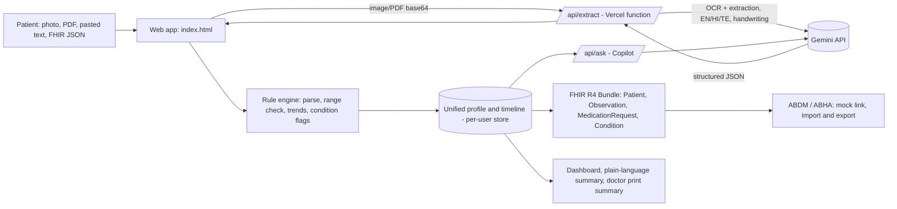

# Medoryx Architecture

## Data model (FHIR-style)
Patient (ABHA number + PHR address identifiers) · Observation (value, unit, reference range, interpretation) · MedicationRequest (name, dose, schedule) · Condition (diagnosis, date).

## Safety
Wording says information only; conditions flagged "Suspected" need a doctor; AI never advises starting or stopping medicines; emergencies point to 112.

## Production next steps
Supabase/Postgres for accounts and records, encrypted storage for uploads, live ABDM sandbox integration.

## App data to FHIR mapping (Supabase `health_data`)
`health_data.data` (jsonb) holds the app's records; `health_data.fhir_bundle` (jsonb, checked to be a Bundle) holds a FHIR R4 snapshot generated from them. Row-level security limits both to the owner.
| App record field | FHIR resource and element |
|---|---|
| profile name, sex, ABHA number and address (mock) | Patient.name, gender, identifier |
| lab row (name, value, unit, low, high, date) | Observation.code (LOINC where mapped), valueQuantity (UCUM where mapped), referenceRange, effectiveDateTime |
| lab row verified/unverified | Observation.status `final` / `preliminary` |
| medicine row | MedicationRequest.medicationCodeableConcept, dosageInstruction, authoredOn (status `active` / `draft`) |
| diagnosis text | Condition.code.text, recordedDate |
Not normalized into one table per resource; the Bundle is a snapshot. Safety layer: urgent-symptom check before any AI call, multilingual output filter after (see SAFETY.md).
